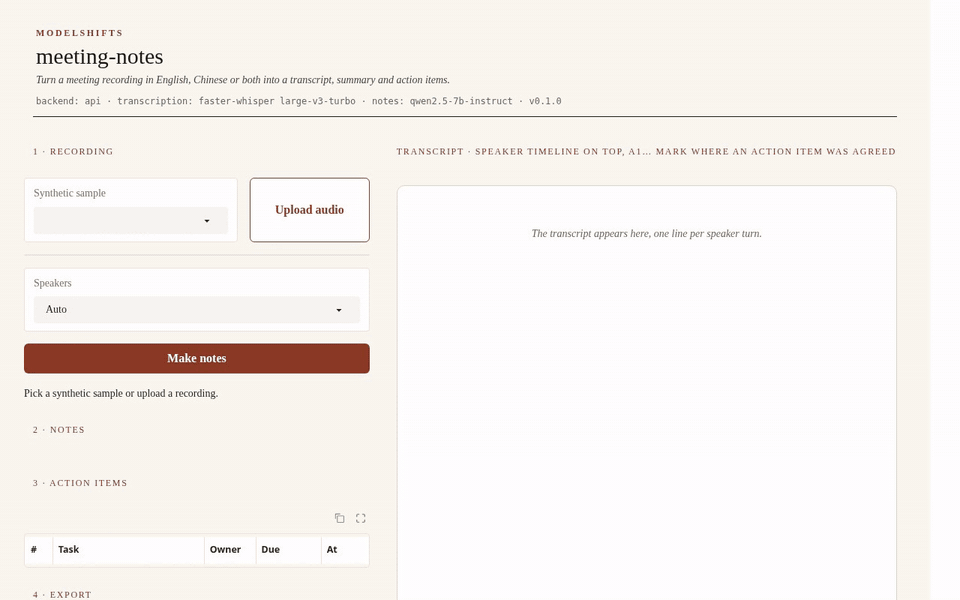
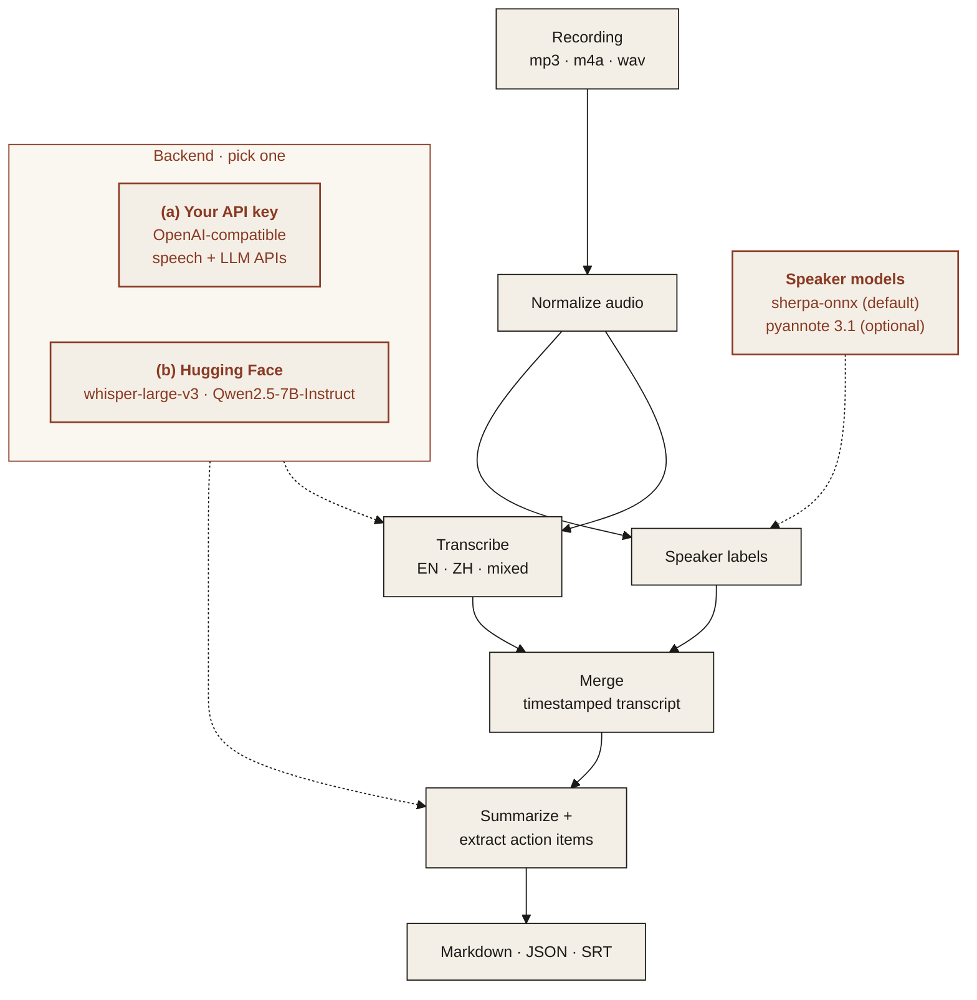

<p align="center">
  
</p>

<p align="center"><em>Turn a meeting recording in English, Chinese or both into a transcript, summary and action items.</em></p>

<p align="center">
  
  
  
  
</p>

---

## Features

All five features below work in v1. See [Limitations](#limitations) for what they do not cover yet.

- **Mixed-language transcription**: English, Chinese, or both in the same sentence.
- **Speaker labels**: who said what, with timestamps.
- **Summary**: the decisions and key points in a few lines.
- **Action items**: each with an owner and a due date when one was mentioned.
- **Export**: Markdown, JSON and subtitles (SRT).

<p align="center">
  
</p>
<p align="center"><sub>Web demo on a synthetic meeting (<a href="assets/demo.mp4">MP4</a>). Results in the recording were computed earlier by faster-whisper small and Qwen2.5-1.5B-Instruct on CPU and loaded from the demo's result cache.</sub></p>

## Architecture



### Two interchangeable backends

Pick one with `MS_BACKEND` in `.env`. The rest of the pipeline does not change.

| | (a) Bring your own API key | (b) Open-source on Hugging Face |
|---|---|---|
| **What** | Any OpenAI-compatible endpoint | Open models, run locally |
| **Set** | `MS_BACKEND=api`, `MS_API_BASE`, `MS_API_KEY`, `MS_MODEL` | `MS_BACKEND=hf`, optionally `MS_HF_MODEL` |
| **Transcription** | `MS_STT_MODEL` on an `/audio/transcriptions` endpoint; if empty, local faster-whisper | faster-whisper, `MS_WHISPER_MODEL` |
| **Good for** | Fastest start, strongest hosted models | Data stays on your machines, no per-call cost |

Speaker labels always run locally with sherpa-onnx, which needs no account or token. The gated pyannote pipeline can be used instead (see below).

**Default open-source models**

| Model | Used for | License |
|---|---|---|
| [`openai/whisper-large-v3`](https://huggingface.co/openai/whisper-large-v3) | transcription, run through the CTranslate2 copy [`Systran/faster-whisper-large-v3`](https://huggingface.co/Systran/faster-whisper-large-v3) (MIT) | Apache-2.0 |
| [`openai/whisper-large-v3-turbo`](https://huggingface.co/openai/whisper-large-v3-turbo) | faster transcription (`MS_WHISPER_MODEL=large-v3-turbo`) | MIT |
| [pyannote segmentation 3.0](https://huggingface.co/pyannote/segmentation-3.0), ONNX copy from [sherpa-onnx](https://github.com/k2-fsa/sherpa-onnx/releases/tag/speaker-segmentation-models) | speaker turns (default, downloaded from GitHub, no token) | MIT |
| [3D-Speaker CAM++ zh/en](https://github.com/k2-fsa/sherpa-onnx/releases/tag/speaker-recongition-models) | voice embeddings for grouping turns by speaker (default) | Apache-2.0 |
| [`pyannote/speaker-diarization-3.1`](https://huggingface.co/pyannote/speaker-diarization-3.1) | speaker labels, optional (gated: accept terms on Hugging Face, set `HF_TOKEN`) | MIT |
| [`Qwen/Qwen2.5-7B-Instruct`](https://huggingface.co/Qwen/Qwen2.5-7B-Instruct) | summary and action items | Apache-2.0 |

On a machine without a GPU, set `MS_WHISPER_MODEL=small` and `MS_HF_MODEL=Qwen/Qwen2.5-1.5B-Instruct`. large-v3 and the 7B model are slow on a CPU, and the 7B model needs a GPU or a lot of memory.

## Quickstart

Python 3.11 or newer, and [ffmpeg](https://ffmpeg.org) on the `PATH` (it reads mp3, m4a, wav and video files).

```bash
git clone https://github.com/ModelShifts/meeting-notes
cd meeting-notes
python -m venv .venv && source .venv/bin/activate
pip install -e ".[hf,demo]"      # open models; use ".[api,demo]" for the API backend
cp .env.example .env              # choose a backend and models
```

On a CPU-only machine, install the CPU build of PyTorch first (`pip install torch --index-url https://download.pytorch.org/whl/cpu`) and set `MS_WHISPER_MODEL=small` and `MS_HF_MODEL=Qwen/Qwen2.5-1.5B-Instruct` in `.env`. `MS_HF_DTYPE=bfloat16` halves the memory the 1.5B model needs (about 3 GB instead of 6 GB). Models download on first use.

```bash
# transcript, speaker labels, summary and action items -> notes/<name>.md, .json and .srt
meeting-notes run samples/weekly-sync-en.wav --out notes/

# a speaker-labelled transcript only (no LLM), optionally as subtitles
meeting-notes transcribe samples/sprint-planning-mixed.wav --srt notes/sprint-planning-mixed.srt

# redo the summary and action items from a saved transcript, e.g. with another model
meeting-notes summarize notes/weekly-sync-en.json --out notes/

# the web demo at http://127.0.0.1:7860 (python app.py does the same)
meeting-notes serve
```

`--speakers 3` sets the number of speakers when you know it, and `--language zh` skips language detection.

### Using the API backend

Any OpenAI-compatible endpoint works. In `.env`:

```bash
MS_BACKEND=api
MS_API_BASE=https://your-provider.example/v1
MS_API_KEY=your-api-key
MS_MODEL=your-chat-model
MS_STT_MODEL=your-speech-to-text-model   # leave empty to transcribe locally with faster-whisper
```

`MS_STT_API_BASE` and `MS_STT_API_KEY` point transcription at a different endpoint when needed. Speaker labels are always computed locally.

To try it without a paid key, run an open model behind a local OpenAI-compatible server, for example [llama-cpp-python](https://github.com/abetlen/llama-cpp-python), and the small speech-to-text server in `scripts/`:

```bash
pip install "llama-cpp-python[server]" huggingface_hub \
  --extra-index-url https://abetlen.github.io/llama-cpp-python/whl/cpu   # prebuilt CPU wheels, no compiler needed
hf download Qwen/Qwen2.5-1.5B-Instruct-GGUF qwen2.5-1.5b-instruct-q4_k_m.gguf --local-dir models
python -m llama_cpp.server --model models/qwen2.5-1.5b-instruct-q4_k_m.gguf --n_ctx 8192 --port 8001
python scripts/stt_server.py --model small --port 8002   # faster-whisper behind /v1/audio/transcriptions
# then: MS_API_BASE=http://127.0.0.1:8001/v1  MS_API_KEY=local  MS_MODEL=qwen2.5-1.5b-instruct-q4_k_m
#       MS_STT_MODEL=whisper-small  MS_STT_API_BASE=http://127.0.0.1:8002/v1
```

### Speaker labels

By default speaker turns come from sherpa-onnx: the pyannote segmentation 3.0 model finds who speaks when, CAM++ voice embeddings group the turns, and each transcript word is given the speaker of its turn, so a sentence is split where the speaker changes. Speakers are named `S1`, `S2`, ... in order of first appearance. `MS_CLUSTER_THRESHOLD` (default 0.5) controls how readily two voices are treated as one when the number of speakers is not given.

To use pyannote's own pipeline instead, accept the terms of [`pyannote/speaker-diarization-3.1`](https://huggingface.co/pyannote/speaker-diarization-3.1), then:

```bash
pip install -e ".[pyannote]"
HF_TOKEN=your-hf-token MS_DIARIZER=pyannote meeting-notes run meeting.m4a
```

### Sample meetings and tests

`samples/` holds three synthetic meetings with two speakers each: one in English, one in Chinese and one that mixes both in the same sentences. The speech was made with the open [Kokoro-82M v1.1-zh](https://huggingface.co/hexgrad/Kokoro-82M-v1.1-zh) text-to-speech model (Apache-2.0) through [sherpa-onnx](https://github.com/k2-fsa/sherpa-onnx), with a different voice per speaker. Each recording has a ground-truth file with the script, exact turn times, action items and decisions. All content in them is fictional.

```bash
pip install -e ".[dev]"
python scripts/make_samples.py   # regenerate samples/ from samples/scripts/*.yaml (downloads the TTS model)
pytest                           # mocked recogniser, speaker model and LLM, no downloads
python scripts/evaluate.py       # compare the configured backend with the ground truth
```

The evaluation reports the transcript error rate (WER for English, CER for Chinese, a mixed rate over Chinese characters and English words for the mixed meeting), the share of speech time given the right speaker, and how many scripted action items were found with the right owner and due date.

## Limitations

- The samples are short synthetic recordings of two text-to-speech voices with clean pauses between turns. The project has not been measured on real meetings, which have overlapping speech, noise and more speakers.
- On a CPU, Whisper large-v3 and the 7B model are slow. The small models are usable on a CPU but make more mistakes: Whisper small mishears some words (especially English words inside Chinese sentences), and Qwen2.5-1.5B sometimes gives a task to the wrong speaker, misses a task or lists a decision as a task.
- Owners are speaker labels (`S1`, `S2`) or a team named in the meeting. The tool does not know people's names.
- Speaker labels assume one person speaks at a time. Overlapping speech is given to one speaker, and two similar voices can be merged into one label.
- Due dates are kept as spoken ("Friday", "下周二") and are not turned into calendar dates.
- Long meetings are summarised in parts of about 9,000 characters and the parts are then merged, so a decision that spans parts can be repeated or missed.
- On the API backend, transcription has been tested with the local `scripts/stt_server.py` stand-in, not with a hosted speech API.
- When the language is not set, the local path detects it and gives Whisper a short Chinese prompt for Chinese audio, which matters for mixed meetings. A hosted speech API gets that prompt only when `MS_LANGUAGE=zh` is set, so set it for Chinese or mixed meetings on the API backend.
- Whisper can invent text in silent stretches. Known subtitle-credit lines are removed, but other invented lines can remain.
- The web demo saves results under `.cache/results` and reuses them for the same file, speaker count and models.

## Roadmap

- [x] Repository scaffold and README
- [x] Transcription with either backend
- [x] Speaker labels
- [x] Summary and action items
- [x] Markdown, JSON and SRT export
- [x] Web demo
- [ ] Speaker names (map `S1`, `S2` to names given by the user)
- [ ] Due dates resolved to calendar dates from the meeting date
- [ ] Tested on real recordings with overlapping speech
- [ ] Hosted demo

## License

[MIT](LICENSE) © Modelshifts Technology Pte. Ltd.

<p align="center"><sub>Part of the <a href="https://modelshifts.com/work">Modelshifts</a> showcase.</sub></p>
