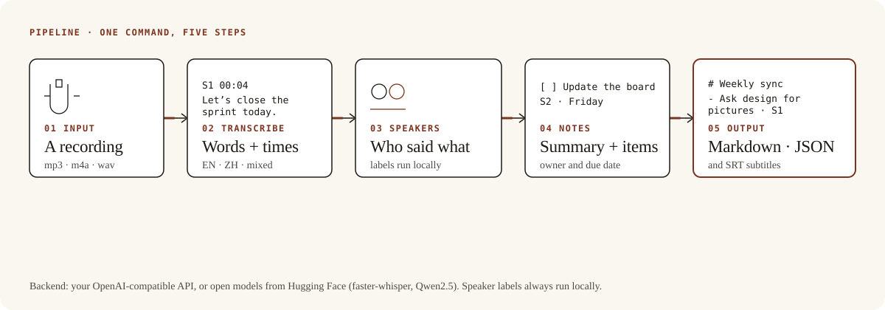
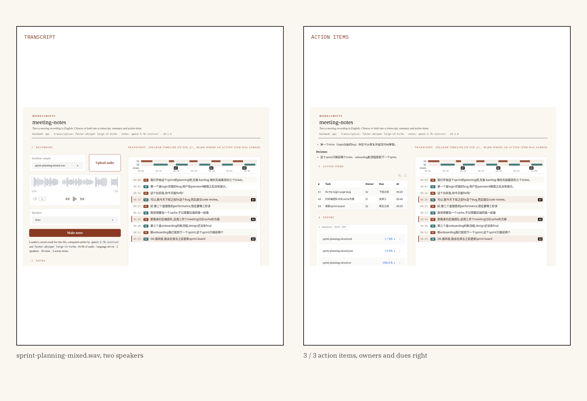

<p align="center">
  
</p>

<p align="center"><strong>A recording goes in. A transcript, a summary and a list of action items come out — each item with an owner and a due date when one was said.</strong></p>

<p align="center">
  <a href="https://github.com/ModelShifts/meeting-notes/actions/workflows/ci.yml"></a>
  
  
  
  
</p>

<p align="center">
  
</p>
<p align="center"><sub>Web demo on a synthetic mixed-language meeting (<a href="assets/demo.mp4">MP4</a>). The recording replays results computed by faster-whisper large-v3-turbo and Qwen2.5-7B-Instruct (Q4_K_M) on CPU.</sub></p>

<p align="center">
  
</p>

## The problem

Imagine a weekly standup recorded in a mix of English and Chinese. Afterwards someone listens again to write down who said they would do what, and by when. A missed “Friday” or a task given to the wrong person is easy to let through.

The useful result is not a transcript alone. It is a list of action items — each with an owner and a due date when one was said — that a person can check against the words.

## How it works

The pipeline is five steps.

1. A recording comes in (mp3, m4a, wav, or a video file ffmpeg can read).
2. The audio is transcribed, in English, Chinese, or both in the same sentence.
3. Speaker labels are assigned locally — who said what, with timestamps.
4. A model writes a short summary and a list of action items. Each item has an owner and a due date when one was mentioned, and must quote a transcript line; items whose quote is not found are dropped.
5. You get Markdown, JSON and subtitles (SRT).

<p align="center">
  
</p>
<p align="center"><sub>The same five steps, whether the backend is your API or open models on your own machine. Speaker labels always run locally.</sub></p>

One of the samples, before and after:

<p align="center">
  
</p>
<p align="center"><sub>Synthetic meeting <code>sprint-planning-mixed.wav</code>. 3/3 action items, owners and dues right. Measured by <a href="scripts/evaluate.py"><code>scripts/evaluate.py</code></a>.</sub></p>

## Results

On three synthetic meetings — one English, one Chinese, and one that mixes both in the same sentences — the API backend with faster-whisper large-v3-turbo and Qwen2.5-7B-Instruct (Q4_K_M) found **10 of 10 action items**, with **10/10 owners** right and **9/10 due dates** right. Precision was **10/10** (no extra items). Transcript error was CER 2.0% (Chinese), MER 1.1% (mixed) and WER 0.6% (English). Speakers were 2/2 on every sample, with 99%, 97% and 96% of speech time given the right label.

The one due-date miss is on `weekly-sync-en.wav`: the item “Ask the design team for the new pictures for the app store” came back with no due date, against the scripted “today.” On the Chinese meeting, one of two scripted decisions was listed (1/2); the other two meetings listed every scripted decision (1/1, 1/1).

| Sample | Lang | Transcript | Speakers | Items | Owner | Due | Precision | Time (s) | Notes |
|---|---|---|---|---|---|---|---|---|---|
| design-review-zh.wav | zh | CER 2.0% | 2/2 (99%) | 3/3 | 3/3 | 3/3 | 3/3 | 93 | decisions 1/2 |
| sprint-planning-mixed.wav | mixed | MER 1.1% | 2/2 (97%) | 3/3 | 3/3 | 3/3 | 3/3 | 101 | — |
| weekly-sync-en.wav | en | WER 0.6% | 2/2 (96%) | 4/4 | 4/4 | 3/4 | 4/4 | 191 | due None vs “today” |
| **All** | | | | **10/10** | **10/10** | **9/10** | **10/10** | **93–191** | |

**Methodology.** Three synthetic meetings (Kokoro TTS, two speakers each), ten scripted action items in total. All content is fictional. An item counts as found when the notes list a matching task whose quote aligns to a transcript line; owner and due are scored only on items that were found. Precision is found items over items listed. Run with [`python scripts/evaluate.py`](scripts/evaluate.py). API backend, faster-whisper large-v3-turbo, Qwen2.5-7B-Instruct (Q4_K_M) behind a local llama.cpp server, sherpa-onnx speaker labels, 8-core CPU (15 GB RAM, no GPU), 12 November 2026. Per-meeting times were 93, 101 and 191 seconds. The two models together used about 14 GB of RAM. The raw table is in [`docs/eval.md`](docs/eval.md). Ground truth is in [`samples/`](samples/).

On the same machine, the Hugging Face backend with Whisper `small` and Qwen2.5-1.5B-Instruct found 9 of 10 action items (6/9 owners, 6/9 dues, 9/14 precision). Transcript error was higher on the Chinese and mixed meetings (CER 6.3%, MER 6.3%; English WER stayed 0.6%). Times were 31–36 seconds. The raw table is in [`docs/eval-hf.md`](docs/eval-hf.md).

## Why it matters

A transcript you still have to read is only half the job. A list of action items, each tied to a speaker and a spoken due date, is something a person can check and then use — and because every item has to quote a transcript line, the notes do not invent tasks. They can still leave things out, and a due date can be missed, as the table above shows.

It fits anywhere a team already records meetings and types the follow-ups by hand. The backend can be a hosted API or open models on your own machine; speaker labels always run locally. The rest of the pipeline stays the same.

## Quickstart

Python 3.11 or newer, and [ffmpeg](https://ffmpeg.org) on the `PATH`.

```bash
git clone https://github.com/ModelShifts/meeting-notes
cd meeting-notes
python -m venv .venv && source .venv/bin/activate
pip install -e ".[hf,demo]"      # open models; use ".[api,demo]" for the API backend
cp .env.example .env              # choose a backend and models
```

On a CPU-only machine, install the CPU build of PyTorch first (`pip install torch --index-url https://download.pytorch.org/whl/cpu`) and set `MS_WHISPER_MODEL=small` and `MS_HF_MODEL=Qwen/Qwen2.5-1.5B-Instruct` in `.env` if you need a smaller memory footprint. The headline figures above used `large-v3-turbo` and the 7B GGUF, which take about 14 GB of RAM together. Models download on first use.

```bash
# transcript, speaker labels, summary and action items -> notes/<name>.md, .json and .srt
meeting-notes run samples/weekly-sync-en.wav --out notes/

# a speaker-labelled transcript only (no LLM), optionally as subtitles
meeting-notes transcribe samples/sprint-planning-mixed.wav --srt notes/sprint-planning-mixed.srt

# redo the summary and action items from a saved transcript, e.g. with another model
meeting-notes summarize notes/weekly-sync-en.json --out notes/

# the web demo at http://127.0.0.1:7860 (python app.py does the same)
meeting-notes serve
```

`--speakers 3` sets the number of speakers when you know it, and `--language zh` skips language detection.

`samples/` holds three synthetic meetings with a ground-truth file for each. All content in them is fictional. Tests use a mocked recogniser, speaker model and LLM, and need no downloads: `pip install -e ".[dev]" && pytest`.

## Backends

<details>
<summary>Two interchangeable backends — API key or open models. Speaker labels always run locally. The rest of the pipeline does not change.</summary>

Pick one with `MS_BACKEND` in `.env`.

| | (a) Bring your own API key | (b) Open-source on Hugging Face |
|---|---|---|
| **What** | Any OpenAI-compatible endpoint | Open models, run locally |
| **Set** | `MS_BACKEND=api`, `MS_API_BASE`, `MS_API_KEY`, `MS_MODEL` | `MS_BACKEND=hf`, optionally `MS_HF_MODEL` |
| **Transcription** | `MS_STT_MODEL` on an `/audio/transcriptions` endpoint; if empty, local faster-whisper | faster-whisper, `MS_WHISPER_MODEL` |
| **Good for** | Fastest start, hosted models | Data stays on your machines, no per-call cost |

**Default open-source models**

| Model | Used for | License |
|---|---|---|
| [`openai/whisper-large-v3`](https://huggingface.co/openai/whisper-large-v3) | transcription, run through the CTranslate2 copy [`Systran/faster-whisper-large-v3`](https://huggingface.co/Systran/faster-whisper-large-v3) (MIT) | Apache-2.0 |
| [`openai/whisper-large-v3-turbo`](https://huggingface.co/openai/whisper-large-v3-turbo) | faster transcription (`MS_WHISPER_MODEL=large-v3-turbo`) | MIT |
| [pyannote segmentation 3.0](https://huggingface.co/pyannote/segmentation-3.0), ONNX copy from [sherpa-onnx](https://github.com/k2-fsa/sherpa-onnx/releases/tag/speaker-segmentation-models) | speaker turns (default, downloaded from GitHub, no token) | MIT |
| [3D-Speaker CAM++ zh/en](https://github.com/k2-fsa/sherpa-onnx/releases/tag/speaker-recongition-models) | voice embeddings for grouping turns by speaker (default) | Apache-2.0 |
| [`pyannote/speaker-diarization-3.1`](https://huggingface.co/pyannote/speaker-diarization-3.1) | speaker labels, optional (gated: accept terms on Hugging Face, set `HF_TOKEN`) | MIT |
| [`Qwen/Qwen2.5-7B-Instruct`](https://huggingface.co/Qwen/Qwen2.5-7B-Instruct) | summary and action items | Apache-2.0 |

To try the API backend without a paid key, run an open model behind a local OpenAI-compatible server, for example [llama-cpp-python](https://github.com/abetlen/llama-cpp-python):

```bash
pip install "llama-cpp-python[server]" huggingface_hub \
  --extra-index-url https://abetlen.github.io/llama-cpp-python/whl/cpu
hf download Qwen/Qwen2.5-7B-Instruct-GGUF --include "qwen2.5-7b-instruct-q4_k_m*.gguf" --local-dir models
python -m llama_cpp.server --model models/qwen2.5-7b-instruct-q4_k_m-00001-of-00002.gguf \
  --model_alias qwen2.5-7b-instruct --n_ctx 8192 --port 8001
# then: MS_API_BASE=http://127.0.0.1:8001/v1  MS_API_KEY=local  MS_MODEL=qwen2.5-7b-instruct
#       MS_WHISPER_MODEL=large-v3-turbo   (local transcription)
```

`MS_STT_HOTWORDS` takes a comma-separated list of meeting terms given to Whisper as context. Due dates are kept as spoken (“Friday”, “下周二”) and are not turned into calendar dates. Owners are speaker labels (`S1`, `S2`) or a team named in the meeting.

</details>

## Notes

- Measured on three short synthetic meetings (two text-to-speech voices, clean pauses), not on real recordings.
- The 10/10 figures are for faster-whisper large-v3-turbo and Qwen2.5-7B-Instruct (Q4_K_M), which take about 14 GB of RAM together. The 1.5B setup has also been measured (9/10 recall).
- Even with the larger models, a due date can be missed and a decision can be left out, as the table above shows.
- Speaker labels assume one person speaks at a time. Overlapping speech is given to one speaker.

## Roadmap

- [ ] Speaker names (map `S1`, `S2` to names given by the user)
- [ ] Due dates resolved to calendar dates from the meeting date
- [ ] Tested on real recordings with overlapping speech
- [ ] Hosted demo

## License

[MIT](LICENSE) © Modelshifts Technology Pte. Ltd.

<p align="center"><sub>Part of the <a href="https://modelshifts.com/work">Modelshifts</a> showcase. November 2026, v1.</sub></p>
