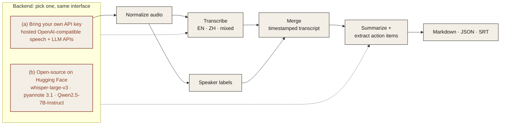

<p align="center">
  
</p>

<p align="center"><em>Turn a meeting recording in English, Chinese or both into a transcript, summary and action items.</em></p>

<p align="center">
  
  
  
  
</p>

---

## Features

- **Mixed-language transcription**: English, Chinese, or both in the same sentence.
- **Speaker labels**: who said what, with timestamps.
- **Summary**: the decisions and key points in a few lines.
- **Action items**: each with an owner and a due date when one was mentioned.
- **Export**: Markdown, JSON and subtitles (SRT).

## Architecture



### Two interchangeable backends

Pick one with `MS_BACKEND` in `.env`. The rest of the pipeline does not change.

| | (a) Bring your own API key | (b) Open-source on Hugging Face |
|---|---|---|
| **What** | Any OpenAI-compatible endpoint | Open models, run locally or via Hugging Face Inference |
| **Set** | `MS_BACKEND=api`, `OPENAI_BASE_URL`, `OPENAI_API_KEY` | `MS_BACKEND=hf`, `HF_MODE=local` or `inference` |
| **Good for** | Fastest start, strongest hosted models | Data stays on your machines, no per-call cost |

**Default open-source models**

| Model | Used for | License |
|---|---|---|
| [`openai/whisper-large-v3`](https://huggingface.co/openai/whisper-large-v3) | transcription | Apache-2.0 |
| [`openai/whisper-large-v3-turbo`](https://huggingface.co/openai/whisper-large-v3-turbo) | faster transcription | MIT |
| [`pyannote/speaker-diarization-3.1`](https://huggingface.co/pyannote/speaker-diarization-3.1) | speaker labels (gated: accept terms on Hugging Face) | MIT |
| [`Qwen/Qwen2.5-7B-Instruct`](https://huggingface.co/Qwen/Qwen2.5-7B-Instruct) | summary and action items | Apache-2.0 |

## Quickstart

> **Coming soon.** The commands below show the planned interface.

```bash
git clone https://github.com/ModelShifts/meeting-notes
cd meeting-notes
cp .env.example .env   # choose a backend
pip install -e .
meeting-notes run weekly-sync.m4a --out notes/
```

## Try it

> **Coming soon.** A hosted demo will be linked here and on [modelshifts.com/work](https://modelshifts.com/work).

## Roadmap

- [x] Repository scaffold and README
- [ ] Transcription with either backend
- [ ] Speaker labels
- [ ] Summary and action items
- [ ] Markdown, JSON and SRT export
- [ ] Web demo

## License

[MIT](LICENSE) © Modelshifts Technology Pte. Ltd.

<p align="center"><sub>Part of the <a href="https://modelshifts.com/work">Modelshifts</a> showcase.</sub></p>
